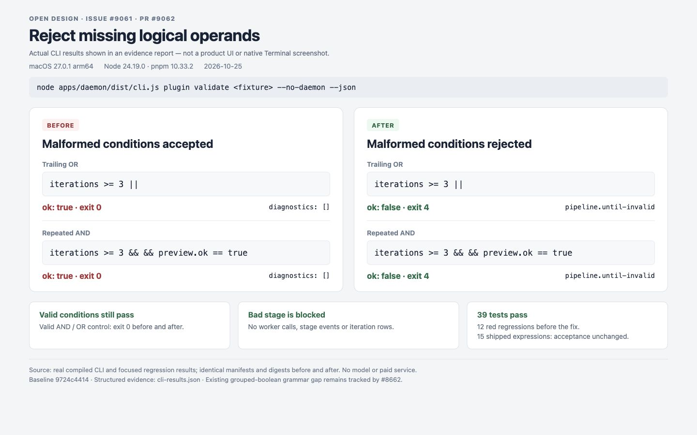

# Missing operands in `until` expressions

Baseline: `9724c44142ea0afaee3d207f37901b31c66a44ad`.
Environment: macOS 27.0.1 arm64, Node 24.19.0, pnpm 10.33.2.

## Actual CLI reproduction

The real compiled CLI validated the same local plugin manifests before and
after the parser change. No daemon, agent, provider, or paid model was used.

```sh
node apps/daemon/dist/cli.js plugin validate <fixture> --no-daemon --json
```

The fixture has this manifest and a minimal SKILL.md:

```json
{
  "name": "until-repro",
  "version": "0.1.0",
  "title": "Until syntax reproduction",
  "od": {
    "taskKind": "new-generation",
    "pipeline": {
      "stages": [{
        "id": "critique",
        "atoms": ["critique-theater"],
        "repeat": true,
        "until": "iterations >= 3 ||"
      }]
    }
  }
}
```

| Condition | Baseline | Fixed |
| --- | --- | --- |
| `iterations >= 3 \|\|` | `ok: true`, exit 0 | `ok: false`, `pipeline.until-invalid`, exit 4 |
| `iterations >= 3 && && preview.ok == true` | `ok: true`, exit 0 | `ok: false`, `pipeline.until-invalid`, exit 4 |
| `iterations >= 3 && preview.ok == true \|\| user.confirmed == true` | `ok: true`, exit 0 | Same |

[Structured CLI results](cli-results.json) preserve the response fields and
matching manifest digests; only local fixture paths are normalized.

## Visual comparison



This is a browser screenshot of [the recorded-results page](comparison.html),
not an OpenDesign product UI or native Terminal screenshot.

## Regression checks

- Before implementation, 12 new cases failed across the parser, plugin
  validator and pipeline runner; 26 controls passed.
- After implementation, 4 focused files / 39 tests passed.
- The single-stage runner cases verify that malformed conditions throw
  `PipelineConfigError` before the affected worker runs, emits stage events,
  or persists iteration rows.
- The real CLI rejects both malformed manifests and still accepts the valid
  AND/OR control after rebuilding the daemon.
- All 15 `until` expressions found in shipped plugin manifests retain their
  acceptance result. The existing `od-code-migration` grouped-boolean failure
  remains tracked by #8645 / #8662.
- Applying the same source-line change to #8662 head `90fc01102` preserves two
  representative grouped/bare-boolean expressions and rejects four malformed
  examples. This is a compatibility smoke check, not a merge of that PR.
- `pnpm guard`, root `pnpm typecheck`, daemon build, and `git diff --check` pass.

The fix preserves empty split operands so the existing comparison parser
rejects them. It does not extend the grammar or change numeric-literal rules;
those separate changes remain in #8662 and #8647.
